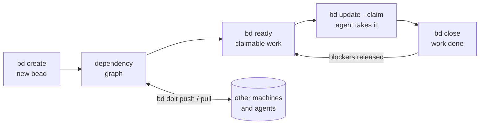

# BeadsHX

BeadsHX is an experimental Haxe-to-Go port of
[Beads](https://github.com/gastownhall/beads). The current compatibility target
is Beads v1.2.1.

BeadsHX is not a stable replacement for `bd`. The port is incomplete, and no
BeadsHX release is available. Haxe owns new application behavior under
`src/beadshx/`. The project uses the upstream `bd` binary only as a named test
oracle. A BeadsHX release build never delegates commands to that binary.

[](https://github.com/fullofcaffeine/beadshx/actions/workflows/beadshx-bootstrap.yml)
[](LICENSE)

Read [the port specification](beadshx-complete-port-prd.md) and
[the source index](engdocs/beadshx/program/source-index.md) for the current
scope and evidence. Use upstream Beads for production work.

## What BeadsHX runs today

`bdhx` implements these read-only commands in authored Haxe. Parity tests run
each command with `bdhx` and with upstream `bd` v1.2.1 on the same disposable
workspaces, and require the same stdout, stderr and exit code:

- **Workspace and status:** `version`, `where`, `info`, `ping`, `status`
  (also `stats`).
- **Issue queries:** `list`, `show`, `children`, `search`, `query`, `count`,
  `ready`, `stale`, `orphans`, `comments`, `label list`, `label list-all`,
  `history` (also `--events`).
- **Dependencies and graphs:** `dep list`, `dep tree`, `dep cycles`,
  `blocked`, `graph check`, and `graph` for one issue or `--all`, in every
  view (default, `--compact`, `--open`, `--box`, `--dot`, `--html`,
  `--json`).
- **Reference lists:** `types` (also `--sections`), `statuses`. They read
  custom types and statuses from the database, the same `config.yaml` files
  as `config get`, and `BD_TYPES_CUSTOM` and `BD_STATUS_CUSTOM`, in upstream's
  order.
- **Events journal:** `events`, `events tail` (also `--since`, `--limit`),
  `events export` (also `--limit`).
- **Configuration:** `config get <key>`, `config list` and `config show`
  (also `--source`). They read the database `config` table, `config.yaml`,
  `config.local.yaml`, the user `config.yaml`, `BD_*` variables and the
  defaults in upstream's order. `config show` also lists the
  `.beads/metadata.json` fields, git's `beads.role` and `BEADS_MAX_ROWS`, and
  leaves out the `kv.` rows. Like upstream, they print secret values in full,
  without redaction.
- **Configuration checks:** `config validate` checks the values in
  `config.yaml` and `.beads/metadata.json`, and the sync settings
  (`federation.remote`, its URL and allowed patterns, and
  `federation.sovereignty`). `config drift` checks the git hooks, the Dolt
  remote and the Dolt server state. Both also run with `--json`, and neither
  writes.

Like upstream, every command above prints JSON, exactly as with `--json`,
when `json: true` is set in `config.yaml`, `config.local.yaml` or the user
`config.yaml`, or when `BD_JSON` is true. `BD_JSON` is true for `1`, `t`, `T`,
`true`, `True` and `TRUE`, and false for any other value. An empty `BD_JSON`
is ignored. `BD_JSON` outranks the files, and `--json`, `--json=false` and
`--format` outrank both. The `--format` flag of `list` and `dep tree` does not
count, but `--format json` always selects JSON. Help pages, `--version` and
flag errors stay text.

Like upstream, `bdhx` loads the `.beads/.env` file of the selected workspace
before it reads any setting. A variable in that file counts as if it were set
in the environment, but a variable that the environment sets, even to an empty
value, keeps its value. This applies to the `BD_*` settings, such as `BD_JSON`
and `BD_LIST_LIMIT`, and to `BEADS_*` variables, such as `BEADS_MAX_ROWS` and
`BEADS_DOLT_SHARED_SERVER`. When no `-C`, `BEADS_DIR`, `BEADS_DB` or `BD_DB`
selects the workspace, `BEADS_DIR`, `BEADS_DB` and `BD_DB` in the `.env` file
of the workspace found from the current directory can select another
workspace first. Then `bdhx` loads the `.env` file of the directory that
upstream sets up first. For `where`, `version` and help pages, a `--db`,
`BEADS_DB`, `BD_DB` or `db` setting path selects it, also when a workspace is
found from the current directory. For a command that reads the database, a
`--db` path or the `db` setting selects it, or else the workspace found, or
else a `BEADS_DB` path. For a redirect, this is the file of the target. The
file has the same format
as upstream's `gotenv`: `KEY=value` or `KEY: value` lines, an optional
`export`, `#` comments, single or double quotes and `$VAR` expansion. If one
line is not valid, `bdhx` ignores the full file, and prints no warning.

Like upstream, `bdhx` follows a `.beads/redirect` file each time that one of
upstream's steps looks up the workspace, and it prints upstream's warnings at
each of these lookups. The warnings are for a target that does not exist, for
a redirect chain, and, when `BD_DEBUG_ROUTING` is set, the routing lines. The
warning for a target without a database prints once for each directory. So a
broken redirect prints its warning as many times as upstream does, for
example 9 times for `where` and 11 times for `count`. These lookups do not
include the Git worktree and jj workspace fallbacks of upstream. When `bdhx`
finds a usage error that upstream finds only in its pre-run or command body,
it prints no redirect warning before the error.

Like upstream, `bdhx` has an agent mode for output that AI agents read.
`BD_AGENT_MODE=1` or any `CLAUDE_CODE` value that is not empty turns it on,
also from the `.beads/.env` file. In agent mode, the flat `list` view
(`--flat`, also with `--long`) prints one `ID: Title` line for each issue. A
dependency note in parentheses follows when the issue has a parent, a blocker
or a dependent. The view prints no status icon, priority, type, labels or
`--skip-labels` footer. When stdout is a terminal, `list` shows 20 issues by
default instead of 50. `show` prints Markdown text as it is stored, without
wrapping. The tree view of `list`, `--format` and `--json` do not change.

Like upstream, `list` (every text view, also `children` and `--watch`),
`ready` (the default, `--pretty` and `--plain` views and their notes), the
`query` list, `show` (every text view, also `--short`, `--children`,
`--refs`, `--thread` and `--watch`), `blocked`, the `--explain`, `--mol` and
`--gated` views of `ready`, `dep list`, `dep tree`, `dep cycles`, `graph`
(every text view, also `graph check`), `history`, `label list`,
`label list-all`, `stale`, `orphans`, `status` (also `stats`), `statuses` and
`ping` print colors. Like upstream, `dep tree` prints the `[READY]` and
`[BLOCKED]` marks in bold also when colors are off. Colors are on when stdout
is a terminal, or when `CLICOLOR_FORCE` has any value that is not empty, also
`0` and also with `TERM=dumb`. Colors are off when `NO_COLOR` is not empty,
`CLICOLOR=0` or `BD_GIT_HOOK=1` is set, `TERM` is `dumb` (without
`CLICOLOR_FORCE`), or `--no-color` is given. `bdhx` decides this from the
environment at start, as upstream does, so a value from the `.beads/.env` file
does not change it. The colors are upstream's 24-bit Ayu colors, whatever
`TERM` says, and the `lipgloss` library prints them. When stdin and stdout are
both terminals, `bdhx` asks the terminal whether its background is dark or
light; otherwise it uses the dark colors. Also when colors are off, `bdhx`
changes each tab to four spaces in the parts that upstream styles, such as the
title of a closed issue.

Like upstream, `show` prints the close reason on one metadata line when it
has no line break and fits the Markdown wrap width. This width is the
terminal width, but not more than 100 columns, or 80 columns when stdout is
not a terminal. In agent mode, the width has no limit. A close reason that
does not fit goes into a `CLOSE REASON` section after the metadata lines.
When stderr is a terminal and the limit hides more issues, `list` and `query`
print upstream's hint about `--limit` on stderr.

Like upstream, a command that reads the database uses `BEADS_DB` only when no
`--db`, `-C` or `BEADS_DIR` is set and no workspace is found from the current
directory. These commands ignore `BD_DB`. For `where`, `version` and help
pages, `BEADS_DB`, or else `BD_DB`, comes before `-C`, `BEADS_DIR` and the
current directory; only `--db` comes first. The path, absolute or relative to
the current directory, can name the workspace directory (such as `.beads`),
its `embeddeddolt` directory, or a missing file in a `.beads` directory, such
as a legacy `beads.db`. `bdhx` then reads that workspace with its
`config.yaml` and `.env` file. `info` prints the database path that upstream
takes from `BEADS_DB`: the absolute path with symbolic links resolved, or the
database directory inside it. For a missing file, that is the file. On macOS,
upstream and `bdhx` take the letter case of each name from the file system
there, and also when they derive the directory that a path selects, so a path
typed in another case prints as stored.

Like upstream, `bdhx` reads the selected workspace's `.beads/metadata.json`
(or, when it does not exist, a legacy `.beads/config.json`) before any
command runs. If the file cannot be read or does not decode, `bdhx` prints
upstream's `warning: load ...` line. Then `where` and every command that reads
the database fail with `Error: loading config: ...` and exit code 1, also with
`--json`. The error texts are Go's own `encoding/json` errors, for example
for a number where upstream expects a string, or for a syntax error. `version`,
the root help and `bd help <command>` print only the warning, and a `--help`
flag prints no warning. Unknown keys, `null` values and repeated keys (the
last one counts) are accepted, as in upstream. The name of the embedded
database comes from `BEADS_DOLT_SERVER_DATABASE`, or else from
`dolt_database`, or else it is `beads`. As in Dolt, the letter case of the
name does not matter. Like upstream, `bdhx` matches the `dolt.mode` setting to
`server`, and a `dolt_mode` of `proxied-server` when it decides whether a
server host implies server mode, with Go's `strings.EqualFold`. So `ſerver`
(with U+017F) selects server mode in the setting, but not in `dolt_mode`.

When the selected workspace has no `.beads/metadata.json` and no legacy
`.beads/config.json`, every command that reads the database uses the embedded
database `beads`, as upstream does. Before it opens the database, `bdhx` prints
upstream's `warning: no beads configuration found in <dir>; using default
database name "beads"` on stderr, also with `--json`. With `--db`, `<dir>` is
the directory that upstream derives from the path as given. Upstream ignores
`BEADS_DOLT_SERVER_DATABASE` in this case. `where`, `version` and help pages
print no warning. When such a workspace also has no `.beads/embeddeddolt` or
`.beads/dolt` directory, no remote Dolt host is set, and no `--db` or
`BEADS_DB` path names the database, upstream finds no database. Then `bdhx`
prints only upstream's `Error: no beads database found` and its hint, as
upstream does. This error comes before the `--global` and `--database`
checks, also when `.beads/metadata.json` exists but the embedded store does
not. A `--db` value that names a database counts as no path.

For a `--db` path that no workspace claims, `bdhx` takes the first `.beads`
directory beside the path's directory or above it, as upstream does, or else
the path's directory. `where --db sub/data/x` prints `sub/.beads` when that
directory exists.

Like upstream, a command that reads the database prints upstream's three-line
`Warning: dolt_server_port in metadata.json is deprecated ...` on stderr, also
with `--json`, when it takes the Dolt server port from `dolt_server_port` in
`.beads/metadata.json`. This happens when that port is more than 0 and no
earlier source gives a port: `BEADS_DOLT_SERVER_PORT` (any number), a port
more than 0 in `.beads/dolt-server.port`, a `config.yaml` file in the Dolt
directory, or a `dolt.port` setting more than 0. The warning comes before the
output and the errors of the command, and the exit code does not change.
`where`, `version` and help pages print no warning.

Like upstream, `bdhx` prints `Warning: failed to initialize config: <error>`
first when a `config.yaml` file that it loads at start does not parse. Then it
prints `Warning: failed to reinitialize config for selected beads dir:
<error>` each time upstream sets up the selected workspace and one of its
config files does not parse: `.beads/config.yaml`, `.beads/config.local.yaml`
or the user `config.yaml`. That is once for `version`, the root help and
`bd help <command>`, and twice for `where`. It is twice for every command that
reads the database, or once when a `--db` or `BEADS_DB` path selects the
database or upstream finds no database. A `--db` value that names a database
is not a path, so it gives two warnings. A `--help` flag prints no warning.
The first setup then prints the shared-server notice. A
`.beads/metadata.json` load error stops the first setup after its warning.
Upstream then runs the command with the settings that loaded, and so does
`bdhx`, for every command that reads the database too. `where` still prints
the issue prefix from the embedded database, as upstream does.

Like upstream, each of these setups also prints `Warning: <dir> has
permissions 0755 (recommended: 0700). Run: chmod 700 <dir>` on stderr when
group or others have a permission bit on the selected directory. An execute
bit alone, as in `0711`, also counts. The mode shows as four octal digits. The
warning comes after the config warning of the setup and before its
shared-server notice or `.beads/metadata.json` warning, also with `--json`.
`<dir>` is the directory as that setup names it. A `--db` path, and a
`BEADS_DB`, `BD_DB` or `db` setting path for `where`, `version` and help
pages, give it as the path gives it, for example `.` for `--db .beads` when
`.beads` has no `metadata.json`. For a command that reads the database, a
`BEADS_DB` path gives the absolute path. When `.beads` is a symbolic link,
the second setup of such a command names the target. When a `db` setting
selects the directory of `where`, its second setup names the absolute path.
`bdhx` only reads the mode; it does not change it.

Each command takes the issue prefix from the same source as upstream. `where`
prints `issue-prefix` from `.beads/config.yaml`, or else `issue_prefix` from
that file, or else the `issue_prefix` stored in the database. When an issue ID
does not match exactly, `show` and the other commands that take an issue ID
add and remove the stored `issue_prefix`, also when `config.yaml` names
another prefix. `orphans` takes the `issue-prefix` setting, which
`BD_ISSUE_PREFIX` can set, then the stored prefix, then `bd`. Workspace
discovery reads only `config.yaml`. So commands that do not need the stored
prefix, such as `version` and `count`, do not open the database to read it,
and an exact issue ID does not read it either.

Like upstream, `list`, `ready`, `count`, `query` and `search` check most of
their arguments only after the warnings above and after the database opens. A
`.beads/metadata.json` load error, a missing database or a store error thus
comes first. Errors from the flag parser, such as an unknown flag or a value
that is not a number, still come before all of them. So does the error for a
positional argument to `list`, which takes none. The checks come in
upstream's order:

- `list`: `--skip-labels` with a label filter, `--priority`, `--priority-min`,
  `--priority-max`, `--pinned` with `--no-pinned`, `--parent` with
  `--no-parent`, `--mol-type`, `--wisp-type`, the date filters,
  `--metadata-field`, `--has-metadata-key`, the `--brief` rules, `--deps`,
  `--sort`, `--offset`, and then a negative `--max-rows`.
- `ready`: the `--brief` rules first. Outside a proxied workspace, a positive
  `--offset` fails next, and `--gated`, `--mol` and `--explain` then run
  without the other checks. The default view checks `--mol-type` and the
  `--claim` rules, then a negative `--max-rows`, the metadata filters and
  `--sort`. In a proxied workspace, `ready` reads `--max-rows` and
  `BEADS_MAX_ROWS` after the `--brief` rules. It refuses a cap more than 0
  unless `--claim` is set, then checks a negative `--offset` and the rest.
- `count`: more than one `--by-*` flag, then the date filters.
- `query`: a negative `--offset`, after the check for a missing expression.
- `search`: the check for a missing query, then `--status`, the date filters,
  `--priority-min`, `--priority-max`, `--metadata-field` and
  `--has-metadata-key`. In a proxied workspace, `--status` comes last, and
  the other checks print a JSON error with `--json`. `search` accepts any
  `--sort` value. With a value that it does not know, it keeps the order of
  the database.

Like upstream, `query` orders an expression that the database can answer
alone, such as `status=open`, in the order of the database first. Without
`--sort`, or with a `--sort` value that it does not know, that order is by
priority, then the newest issue first, then the ID. `--reverse` reverses only
the priority. With a `--sort` key, issues that have the same value stay in ID
order. `--limit` keeps the first issues in the order of the database, before
the `--sort` order applies. Other expressions, such as
`status=open OR status=blocked`, keep the priority order, and `--reverse`
without `--sort` does not change it.

The flag parser follows cobra and pflag. It finds the command first, so an
unknown command comes before any flag error. Until it finds the command, it
knows only the flags of the root command. It takes the argument after any
other `--flag` or `-x`, also after a bool flag such as `--all`, as the value of
that flag and not as the command. That argument can be a flag too: in
`--all --title x list`, the search takes `--title` as the value of `--all`,
so `x` names the command. The search stops at `--`. Without a command before
`--`, the root command prints its help. Then the parser reads the flags in
argument order with the flags of that command, without the argument that
names it, and the first problem stops it: a flag that
the command does not have, a value that a flag rejects, or a flag with no
value after it. A flag of another command is unknown also when its value is
bad or missing. A group of shorthands such as `-rtbug` counts as
`-r -t bug`. `--version` (`-V`) is a flag of the root command only. Without
a command, the error comes from the root command, which prints its usage
after the error. `bdhx` checks the `--dolt-auto-commit` value only after all
of these. Like upstream, it accepts an empty `--actor`.

`list` and `ready` print the `BEADS_MAX_ROWS` warning where they read
`--max-rows`, so a check that fails before that point prints no warning.
`BEADS_MAX_ROWS` takes what Go's `strconv.Atoi` takes: an optional sign and
decimal digits in Go's int range. The warning quotes the value as Go's `%q`
does.
`ready --claim` fails after all of these checks with upstream's
`--readonly` error. `bdhx` prints this error also without `--readonly`,
because it does not write.

Like upstream, `list`, `ready` and `children` ask for the role of the user
after these checks and before they read issues. `show`, `comments`,
`dep list` and `dep tree` ask for it each time they do not find an issue ID.
The role is the value of `git config --get beads.role` in the current
directory, so Git's system, global and repository config count. In a jj
secondary workspace, the config of its primary workspace also counts. When the
value is not `maintainer` or `contributor`, for example outside a Git
repository, the command prints upstream's three-line
`warning: beads.role not configured (GH#2950).` on stderr each time it asks,
also with `--json`. In a proxied workspace these commands do not ask. `bdhx`
only reads this setting; it never writes it.

In an embedded workspace, every command that reads the database first
compares the highest version in the `schema_migrations` table with the
version of the binary, v65, as upstream does. Errors from the flag parser
still come first, and this check comes before the other checks of the
command's arguments. When the database is ahead of the binary, the command
stops with upstream's
`schema version mismatch: ... Your bd binary is stale` message on stderr, or
with that error as JSON on stderr under JSON output, and exit code 1. When the
database is behind the binary, the command stops with upstream's `--readonly`
error, `Error: failed to open database: schema version mismatch: ... the
read-only open cannot migrate it ...`, in every output mode. A failed read of
the table stops the command with the same `failed to open database` prefix.
`BD_IGNORE_SCHEMA_SKEW=1` or `--ignore-schema-skew` prints upstream's warning
instead, and the command reads the database. `where` prints no stored prefix
when the check stops, as upstream does. `version` does not check.

The embedded database name must be an identifier: letters, digits and `_`,
and not a digit first. The name comes from `.beads/metadata.json`,
`BEADS_DOLT_SERVER_DATABASE` or a redirecting workspace. For any other name,
such as `my-db` or `my.db`, every command that reads the database stops
before it reads or writes, as upstream does. It prints upstream's error,
`Error: failed to open database: embeddeddolt: init schema: embeddeddolt:
invalid database name: "my-db"`, with upstream's hint when the name has a
hyphen. With `--readonly` or the `readonly` setting, the error is
`Error: failed to open database: embeddeddolt: invalid database name:
"my-db"`, without the hint. The error is text in every output mode. `where`
prints no stored prefix then.

Like upstream, every command that reads the database first takes the
workspace gates: `.beads.gate.lock` beside the `.beads` directory, and the
lock beside the data directory, such as `.beads/embeddeddolt.gate.lock` or
`.beads/dolt.gate.lock`. It tries a shared lock on each lock file once,
without a wait, in path order. While a maintenance command such as `bd init`,
`bd migrate` or `bd backup restore` holds one exclusively, the command stops
with upstream's `Error: a maintenance operation is running on this
workspace; retry when it completes: ...`, which names the lock and its
holder, and exit code 1. With `--json` the error is JSON on stdout. When the
`.beads` directory or the data directory is a symbolic link, for example for
`--db .beads` where `.beads` is a link, the command prints upstream's
`warning: workspace gate unavailable, continuing ungated: ... is a symlink;
...` on stderr, unless `--quiet`, and reads without the locks. `bdhx` opens
each lock file read-only and holds its lock until it exits. `where`,
`version` and help pages take no lock.

Like upstream, `--readonly` also takes a value, such as `--readonly=true` or
`--readonly=0`, in every form that Go's `strconv.ParseBool` accepts.
`--readonly=false` turns the `readonly` setting and `BD_READONLY` off for
one command. Any other value stops the command with upstream's flag error.

**BeadsHX extension: `bdhx snapshot`.** This command prints a read-only
snapshot of every issue in an embedded workspace. Upstream `bd` v1.2.1 has no
such command, so this is a recorded extension
([engdocs/beadshx/program/exceptions.md](engdocs/beadshx/program/exceptions.md)).
The root help does not list it; `bdhx snapshot --help` describes it. It takes
only the global selection inputs (`-C`, `--db`, `BEADS_DIR`, `BEADS_DB`).

The artifact uses schema `beadshx-task-snapshot/1`. It is JSON Lines in
UTF-8, with a line feed after every line:

- Line 1 is a header. Its keys are in byte order: `_dolt_branch`
  (`active_branch()`), `_dolt_commit` (`DOLT_HASHOF('HEAD')`), `_dolt_state`
  (`DOLT_HASHOF_DB()`), `_project_id` (left out when the database has none),
  `_records` (the number of issue lines), `_schema`, `_scope` (`all-issues`)
  and `_sort` (`id-bytewise`).
- Every other line is the line that upstream `bd export --all` prints for one
  issue, including wisps, templates, gates and other infrastructure types,
  sorted by issue ID in byte order. Memories and config rows are not included.

The command reads everything in one Dolt read transaction, which it rolls
back. It writes no file and no database row, and stdout stays empty until the
whole snapshot is read. The same `_dolt_state` gives the same bytes in every
directory, time zone and locale. A change to a wisp, which Dolt never commits,
also moves `_dolt_state`. The artifact holds no config row, remote URL,
credential, environment value, path, actor, host name, time of capture or
`bdhx` version. Errors go to stderr and exit with code 1, also with `--json`.

Choose the file yourself, for example in a git-ignored build directory such as
`build/caf/`: `bdhx snapshot > build/caf/tasks.jsonl`. Never write it under
`.beads/`, where upstream keeps its own `issues.jsonl`. The artifact holds
the task text, so do not commit it to a public repository. Upstream
`bd import` skips the header line, so `bd import <artifact>` restores the
issues into a fresh workspace. Upstream import drops a dependency between a
wisp and a durable issue.

Limits:

- `bdhx` does not write yet. Commands that create, update, close or sync
  issues are not ported.
- Without `--readonly`, upstream migrates a database whose schema is behind
  the binary, and then runs the command. `bdhx` never migrates. It stops with
  upstream's `--readonly` error and leaves the database unchanged. Migration
  parity (M12) removes this limit.
- With `BD_IGNORE_SCHEMA_SKEW=1` on a database that is ahead of or behind the
  binary, a command that opens the native store more than once, such as `show`
  with two IDs or `children`, prints the warning once for each open. Upstream
  prints it once.
- `dep tree`, `dep cycles`, `blocked`, `comments`, `history`, `graph`,
  `types`, `statuses`, `events tail`, `events export`, `config get`,
  `config list`, `config show`, `config validate` and `config drift` read
  embedded workspaces only. In a server-mode or proxied workspace they report
  that they are not available yet. If the server cannot be reached, they print
  the same store error as upstream.
  `types --sections` prints its fixed list in every mode.
- `label list-all` reports that it is not available yet in a proxied
  workspace.
- Upstream also trusts the macOS Shared folder when it decides whether to
  read a workspace's redirect after a command. `bdhx` does not, so for a
  workspace in that folder it prints the redirect warning two times fewer than
  upstream.
- When the target of a redirect has its own redirect to another workspace,
  upstream warns that it ignores that chain. But its later lookups follow the
  second redirect, so upstream's `where` and `info` name the database of that
  other workspace. `bdhx` names the database of the first target.
- `snapshot` reads embedded workspaces only. In a server-mode, shared-server
  or proxied workspace and with `--global`, it reports that it is not
  available yet, before it opens anything.
- `events tail --follow` and `events prune` report that they are not
  available yet.
- `config set`, `set-many`, `unset` and `apply` report that they are not
  available yet. `config get` of a user-global key
  (`metrics.*`, `node_id`) and `config show` report that they are not
  available yet when the user `config.yaml` exists.
- `config show` reports that it is not available yet in a workspace that has
  no database (upstream creates the embedded database there).
- When `--db` selects a workspace whose `.beads/metadata.json` cannot be read
  or does not decode, `where` and every command that reads the database
  report that they are not available yet. For `where`, `BEADS_DB`, `BD_DB`
  and the `db` setting count too. Upstream then prints the path as given, or
  opens or creates a database in another directory. In these cases `version`
  and help pages print no warning.
- When `BEADS_DB` (or, for `where`, `BD_DB`) selects with another path,
  `where` and every command that reads the database report that they are not
  available yet. This applies to a missing path outside a `.beads` directory,
  a directory that is not a workspace, a workspace without an embedded
  database, a server-mode, proxied or redirected workspace, a path deeper in a
  `.beads` directory and a path with a trailing slash. For most of these paths
  upstream creates an embedded database. `version` and help pages still run.
  Before the refusal, `bdhx` sets up the directory that upstream derives from
  the path: like upstream, it loads the `.env` file there and prints the
  config warning and the shared-server notice. For a command that reads the
  database, when `.beads/metadata.json` there does not load, `bdhx` prints
  upstream's `warning: load ...` line and `Error: loading config: ...`
  instead of the refusal. On macOS, a path typed in another letter case, such
  as `DB/.BEADS/embeddeddolt`, is refused too, although upstream reads the
  workspace.
- In a workspace that has a legacy `.beads/config.json` and no
  `.beads/metadata.json`, `where` and every command that reads the database
  stop with `Error: <command> is not available yet when the workspace has
  only a legacy config.json in this build`, also when `-C`, a `--db` path or a
  redirect selects the workspace. Upstream rewrites the file as
  `.beads/metadata.json` and runs them. `bdhx` leaves the file in place.
  `version`, help pages and unknown commands run as upstream does. With a
  `--db` path, upstream also rewrites the file for `version` and
  `bd help <command>`; `bdhx` prints the same output and writes nothing.
  Migration parity (M12) removes this limit.
- In an embedded workspace, every command that reads the database reports
  that it is not available yet when the embedded store has no database with
  the name that `.beads/metadata.json` selects. This applies to `null`, `{}`
  and an empty `dolt_database`, which select `beads`, and to every other
  missing name, also from `BEADS_DOLT_SERVER_DATABASE`. Upstream creates that
  database. With `--readonly` or the `readonly` setting, upstream does not
  create it, and `bdhx` prints the same open error. When a directory or a
  file in `.beads/embeddeddolt` has the name of the missing database,
  upstream fails without a write, and `bdhx` prints the same error.
  `DOLT_DBNAME_REPLACE` counts as in upstream: a directory such as `my-db`
  then holds the database `my_db`. Like upstream, `bdhx` opens the database
  that a redirecting workspace names instead of the target's. Without a
  `--db` path, that workspace is the `.beads` directory of the Git repository
  root, also when `-C` or `BEADS_DIR` selects another workspace. Outside a
  repository it is `BEADS_DIR` or the `-C` workspace, and otherwise the first
  `.beads` directory above the current directory. `bdhx` reports that it is
  not available yet when such a redirect involves a detached commit worktree
  (a path with `/refs/commits/`). `where`, `version` and help pages still
  run.
- In a workspace without `.beads/metadata.json`, every command that reads the
  database prints upstream's warning and then reports that it is not
  available yet when the embedded store has no `beads` database. Upstream
  creates that database. With `--readonly` or the `readonly` setting,
  `bdhx` prints the same open error as upstream. `bdhx` also reports that the
  command is not available yet when `BEADS_DOLT_SERVER_DATABASE` names another
  database, and when `BEADS_DOLT_SERVER_MODE=1` or the `dolt.mode` setting
  selects server mode. Upstream opens `beads` in these cases, but the native
  store open would not. Like upstream, `bdhx` matches the `dolt.mode` setting
  to `server` with Go's `strings.EqualFold`, so `ſerver` (with U+017F) also
  counts. In shared-server mode, `bdhx` prints the warning before the refusal
  below, as upstream prints it before it reaches the shared server.
- Every command above that reads the database reports that it is not
  available yet in shared-server mode and when the `db` setting names a
  database. Only `version`, `where` and help pages still run. In these cases
  upstream connects to the shared server, which creates
  `~/.beads/shared-server/dolt` and a file under `TMPDIR`, or it opens or
  creates the database at that path. `bdhx` refuses before it opens anything,
  and writes nothing. Shared-server mode comes from `dolt.shared-server` in
  `config.yaml`, `config.local.yaml` or the user `config.yaml`, or from
  `BEADS_DOLT_SHARED_SERVER` or `BD_DOLT_SHARED_SERVER`. Like upstream, `bdhx`
  ignores the `db` setting when `--db`, `-C`, `BEADS_DB`, `BD_DB` or
  `BEADS_DIR` selects the workspace. In a shared-server workspace that has no
  database, upstream writes nothing, and these commands run as upstream does:
  they report `no beads database found` with the hint that names `bd doctor`,
  and `config get` of a key that needs no database prints its value.
  `config show`, `config validate` and `config drift` still report that they
  are not available yet there, and so does every command when a `--db` path
  names the database. When `.beads/metadata.json` sets `dolt_mode` to
  `embedded`, upstream prints a three-line notice on stderr in shared-server
  mode, and so does `bdhx`, also before these refusals. Like upstream, it reads
  the metadata of the workspace that a `BEADS_DB`, `BD_DB` or `db` setting path
  selects.
  Like upstream, `where` in shared-server mode reads the issue prefix from the
  embedded database, unless `BEADS_DOLT_SHARED_SERVER` or `dolt_mode` makes the
  workspace a server workspace.
- `config validate` and `config drift` also report that they are not
  available yet with `--global`, when `.beads/metadata.json` names a backend
  other than Dolt, and when a Dolt server host, port or
  socket, `BEADS_DOLT_DATA_DIR` or a central server config is set. In these
  cases upstream connects to a server or creates a database. `config validate`
  also reports this when the workspace directory is not named `.beads` or
  holds its own `redirect` file.
  In an embedded workspace upstream's remote check tries to connect to
  `127.0.0.1:0`; `bdhx` makes the same attempt and prints the same error.
  A `config.yaml` in the Dolt directory that Dolt can read sets the server
  port, to 3306 when the file names none.
- When an issue ID does not match exactly and the database stores no
  `issue_prefix`, `bdhx` uses the prefix from `config.yaml` instead. Upstream
  uses `bd` and then guesses the prefix of each matching issue. With neither
  prefix, `bdhx` does not find a prefixed issue from its hash alone. In a
  server-mode or proxied workspace, `bdhx` does not read the stored prefix
  for this lookup and uses the `config.yaml` prefix; upstream reads the stored
  one.
- In a `.beads/.env` file that is not valid UTF-8, `bdhx` changes each
  invalid byte to U+FFFD. Upstream keeps the byte.
- When stderr is a terminal and `--limit` hides more issues, upstream prints a
  hint after `list --format` output. `bdhx` prints it after `--format dot` and
  `--format digraph`, but not after a Go template.
- When a `list --format` Go template fails on a later issue, upstream has
  already printed the lines of the issues before it. `bdhx` prints only the
  error.
- `bdhx` refuses `ready --claim`, so it never prints upstream's colored
  claim lines. On a terminal with colors on, `bdhx` can ask the terminal for
  its background color twice: once when it starts, in the upstream code of the
  Markdown renderer, and once before the first colored view. Upstream asks
  once.
- `bdhx` prints no tips. Upstream can print a random tip that recommends the
  Beads plugin for Claude Code after `show` and `ready`, and after the flat
  `list` view when agent mode is off. It does this when `CLAUDE_CODE` or
  `ANTHROPIC_CLI` is set or `~/.claude` exists, and the plugin or the
  `bd prime` hooks are not set up. Upstream then records the time of the tip
  in the database, and `bdhx` does not write.
- When a workspace gate lock file is missing, upstream creates it, as an
  empty file with mode 0600, and locks it. `bdhx` does not create it, so it
  reads without that lock and prints the same output. A maintenance command
  that starts during that read can take that lock.
- Upstream opens each workspace gate lock file for writing, and `bdhx` opens
  it read-only. For a lock file that the user can read but not write,
  upstream prints `warning: workspace gate acquisition failed, continuing
  ungated: ...` and reads without the locks. `bdhx` takes the lock and prints
  no warning.
- In an embedded workspace without `.beads/embeddeddolt`, a data directory
  that `BEADS_DOLT_DATA_DIR` or `dolt_data_dir` names makes upstream create
  the embedded database, and a `.beads/dolt` directory makes upstream refuse
  the workspace as a legacy Dolt workspace. `bdhx` prints the native open
  error in both cases. Like upstream, `where` prints that data directory.
- When `.beads` is a symbolic link, `where` prints the link as the workspace
  path, and its second permissions warning names the link. Upstream prints
  the link's target in both places.
- Where upstream output order is random (Go map order), the parity tests
  compare the stable part, and `bdhx` prints one fixed order.
- For an unknown command, `bdhx` prints no `Did you mean this?` list. Upstream
  lists every command whose name starts with the unknown name, or is at most
  two edits away from it. Most of those commands, such as `gc`, `kv`, `lint`
  and `sql`, are not ported yet, so `bdhx` cannot print the same list until
  they are. The parity tests use unknown names that upstream has no
  suggestion for.

Run the parity suite with `make beadshx-parity`; it lives in
[scripts/beadshx/test-parity-smoke.sh](scripts/beadshx/test-parity-smoke.sh).

The handwritten Go islands under `internal/beadshx/` may only shrink.
`make beadshx-test-native-pressure` fails when their non-test lines or imports
grow above
[compatibility/native-islands/baseline.json](compatibility/native-islands/baseline.json),
or when an island calls `configfile.Load` or opens a writable store. After a
deletion, it fails until `go run ./scripts/beadshx/island-guard --update`
lowers the baseline in the same commit.

## Upstream Beads overview

The text below describes the upstream Beads product. BeadsHX keeps this
documentation because upstream behavior is the compatibility authority.

# bd - Beads

**Distributed graph issue tracker for AI agents, powered by [Dolt](https://github.com/dolthub/dolt).**

**Platforms:** macOS, Linux, Windows, FreeBSD

[](https://goreportcard.com/report/github.com/steveyegge/beads)
[](https://github.com/gastownhall/beads/releases)
[](https://www.npmjs.com/package/@beads/bd)
[](https://pypi.org/project/beads-mcp/)

**Docs:** https://beads.gascity.com/

Beads provides a persistent, structured memory for coding agents. It replaces messy markdown plans with a dependency-aware graph, allowing agents to handle long-horizon tasks without losing context.



## ⚡ Upstream Beads Quick Start

```bash
# Install beads CLI (system-wide - don't clone this repo into your project)
curl -fsSL https://raw.githubusercontent.com/gastownhall/beads/main/scripts/install.sh | bash

# Initialize in YOUR project
cd your-project
bd init

# Optional: refresh or install richer instructions for your agent
bd setup codex    # Codex CLI - installs skill, AGENTS.md guidance, and hooks
bd setup claude   # Claude Code - installs hooks/settings
bd setup factory  # Factory.ai Droid - creates/updates AGENTS.md
```

**Note:** Beads is a CLI tool you install once and use everywhere. You don't need to clone this repository into your project.

`bd init` creates or updates `AGENTS.md` by default so agents can discover the beads workflow, and also installs project Claude/Codex integrations unless you pass `--skip-agents` or `--stealth`. Use `bd setup --list` to see supported integrations, including `bd setup codex`, `bd setup factory`, `bd setup claude`, `bd setup mux`, `bd setup cursor`, and more. See [Agent and IDE setup](docs/getting-started/ide-setup.md).

Manual copy-paste is only for unsupported agents, existing projects where you cannot rerun `bd init`/`bd setup`, or custom instruction files. In those cases, run `bd onboard` and paste the printed snippet into the file your agent reads.

If your agent is not covered by `bd setup`, add this minimal `AGENTS.md` section:

```markdown
This project uses bd (beads) for issue tracking.

- Run `bd prime` for workflow context and command guidance.
- Use `bd ready`, `bd show <id>`, `bd update <id> --claim`, and `bd close <id>`.
- Use `bd remember "insight"` for persistent project memory; do not create MEMORY.md files.
- Do not use markdown TODO lists for task tracking.
```

## 🛠 Features

* **[Dolt](https://github.com/dolthub/dolt)-Powered:** Version-controlled SQL database with cell-level merge, native branching, and built-in sync via Dolt remotes.
* **Agent-Optimized:** JSON output, dependency tracking, and auto-ready task detection.
* **Zero Conflict:** Hash-based IDs (`bd-a1b2`) prevent merge collisions in multi-agent/multi-branch workflows.
* **Compaction:** Semantic "memory decay" summarizes old closed tasks to save context window.
* **Messaging:** Message issue type with threading (`--thread`), ephemeral lifecycle, and mail delegation.
* **Graph Links:** `relates-to`, `duplicates`, `supersedes`, and `replies-to` for knowledge graphs.

## 📖 Essential Commands

| Command | Action |
| --- | --- |
| `bd ready` | List tasks with no open blockers. |
| `bd create "Title" -p 0` | Create a P0 task. |
| `bd update <id> --claim` | Atomically claim a task (sets assignee + in_progress). |
| `bd dep add <child> <parent>` | Link tasks (blocks, related, parent-child). |
| `bd show <id>` | View task details and audit trail. |
| `bd prime` | Print agent workflow context and persistent memories. |
| `bd remember "insight"` | Store project memory that `bd prime` injects later. |

## 🔗 Hierarchy & Workflow

Beads supports hierarchical IDs for epics:

* `bd-a3f8` (Epic)
* `bd-a3f8.1` (Task)
* `bd-a3f8.1.1` (Sub-task)

**Stealth Mode:** Run `bd init --stealth` to use Beads locally without committing files to the main repo. Perfect for personal use on shared projects. See [Git-Free Usage](#-git-free-usage) below.

**Contributor vs Maintainer:** When working on open-source projects:

* **Contributors** (forked repos): Run `bd init --contributor` to route planning issues to a separate repo (e.g., `~/.beads-planning`). Keeps experimental work out of PRs.
* **Maintainers** (write access): Beads auto-detects maintainer role via SSH URLs or HTTPS with credentials. Only need `git config beads.role maintainer` if using GitHub HTTPS without credentials but you have write access.

## 📦 Installation

```bash
brew install beads           # macOS / Linux (recommended)
npm install -g @beads/bd     # Node.js users
```

**Other methods:** [install script](docs/getting-started/installation.md#quick-install-script-all-platforms) | [go install](docs/getting-started/installation.md#a-note-on-go-install-capability) | [from source](docs/getting-started/installation.md#build-dependencies-contributors-only) | [Windows](docs/getting-started/installation.md#windows-11) | [Arch AUR](docs/getting-started/installation.md#linux)

**Requirements:** macOS, Linux, Windows, or FreeBSD. See [docs/getting-started/installation.md](docs/getting-started/installation.md) for complete installation guide.

**Upgrading?** Replacing the binary is not always the whole story. Short
version: sync remote-backed databases with your current `bd`, back up with
`bd export --all`, upgrade the binary, then run `bd info --whats-new`,
`bd hooks install`, and `bd version`. If the upgrade crosses a schema
migration on a remote-backed database, exactly one designated clone runs
`bd migrate` and `bd dolt push`; other clones install the new binary
and run `bd bootstrap`. See the full
[upgrade guide](https://beads.gascity.com/getting-started/upgrading)
or [docs/getting-started/installation.md](docs/getting-started/installation.md#updating-bd).

### Security And Verification

Before trusting any downloaded binary, verify its checksum against the release `checksums.txt`.

The install scripts verify release checksums before install. For manual installs, do this verification yourself before first run.

On macOS, `scripts/install.sh` preserves the downloaded signature by default. Local ad-hoc re-signing is explicit opt-in via `BEADS_INSTALL_RESIGN_MACOS=1`.

See [docs/reference/antivirus.md](docs/reference/antivirus.md) for Windows AV false-positive guidance and verification workflow.

## 💾 Storage Modes

Beads uses [Dolt](https://github.com/dolthub/dolt) as its database. Two modes:

- **Embedded (default)** — `bd init`. Dolt runs in-process, data lives in
  `.beads/embeddeddolt/`, single writer. Recommended for most users.
- **Server** — `bd init --server`. Connects to an external `dolt sql-server`
  for multiple concurrent writers; data lives in `.beads/dolt/`.

Cross-machine sync uses `bd dolt push` / `bd dolt pull` against
`refs/dolt/data` on your git remote; `.beads/issues.jsonl` is an export for
viewers and interchange, not the source of truth or a backup. Back up and
migrate between modes with `bd backup`; reclaim space with `bd prune` /
`bd purge`.

Full detail — connection flags, sockets, maintenance, backup, and migration —
in the [Dolt backend guide](docs/architecture/dolt.md).

### Schema Version Guard

`bd` checks the database schema version at open time. If the database has been
migrated by a newer binary and an older binary tries to open it, `bd` exits
with an actionable error rather than issuing queries that fail with cryptic SQL
errors:

````
schema version mismatch: database is at v45, binary knows up to v42 (3 migrations ahead)

  Your bd binary is stale. Queries for dropped or renamed columns will fail
  with cryptic SQL errors (e.g. "column X could not be found in any table in scope").

  Rebuild from main:
    CGO_ENABLED=0 go build -tags gms_pure_go ./cmd/bd

  Or install the latest release:
    CGO_ENABLED=0 go install -tags gms_pure_go github.com/steveyegge/beads/cmd/bd@latest

  To proceed despite the risk (some read commands may still work):
    BD_IGNORE_SCHEMA_SKEW=1 bd <command>
    bd --ignore-schema-skew <command>
````

**When this fires:** only when the database schema is *ahead* of the binary
(a newer binary migrated the database; this binary doesn't know those
migrations). Normal upgrades, where the binary migrates the database forward,
are unaffected.

**Escape hatch:** `BD_IGNORE_SCHEMA_SKEW=1` (or `--ignore-schema-skew`) bypasses
the guard with a warning on stderr. Use this only if you know the forward
migrations are additive and safe for your specific workload.

## 🌐 Community Tools

See [docs/community-tools.md](docs/community-tools.md) for a curated list of community-built UIs, extensions, and integrations—including terminal interfaces, web UIs, editor extensions, and native apps.

See [docs/related-projects.md](docs/related-projects.md) for adjacent or complementary projects that solve different problems in the same neighborhood.

## 🚀 Git-Free Usage

Beads works without git. The Dolt database is the storage backend — git
integration (hooks, repo discovery, identity) is optional.

```bash
# Initialize without git
export BEADS_DIR=/path/to/your/project/.beads
bd init --quiet --stealth

# All core commands work with zero git calls
bd create "Fix auth bug" -p 1 -t bug
bd ready --json
bd update bd-a1b2 --claim
bd prime
bd close bd-a1b2 "Fixed"
```

`BEADS_DIR` tells bd where to put the `.beads/` database directory,
bypassing git repo discovery. `--stealth` sets `no-git-ops: true` in
config, disabling all git hook installation and git operations.

This is useful for:
- **Non-git VCS** (Sapling, Jujutsu, Piper) — no `.git/` directory needed
- **Monorepos** — point `BEADS_DIR` at a specific subdirectory
- **CI/CD** — isolated task tracking without repo-level side effects
- **Evaluation/testing** — ephemeral databases in `/tmp`

## 📝 Documentation

* [Documentation site](https://beads.gascity.com/) | [Installing](docs/getting-started/installation.md) | [Sync Concepts](docs/core-concepts/sync-concepts.md) | [Agent Workflow](AGENT_INSTRUCTIONS.md) | [Copilot CLI Setup](docs/integrations/copilot-cli.md) | [Copilot VS Code MCP](docs/integrations/github-copilot.md) | [Articles](ARTICLES.md) | [Sync Branch Mode](docs/reference/protected-branches.md) | [Troubleshooting](docs/reference/troubleshooting.md) | [FAQ](docs/reference/faq.md)
* [](https://deepwiki.com/gastownhall/beads)
