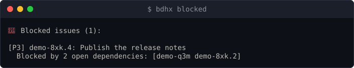
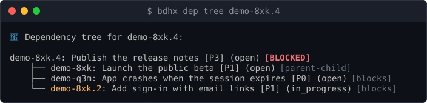

# Read commands

This page lists the commands that `bdhx` runs and describes how they match
upstream `bd` v1.2.1. [Output](output.md) covers JSON, agent mode and
colors. For the differences that remain, see [Limits](limits.md).

## Commands

The command handlers are authored Haxe. Some storage reads still go through
small typed Go facades under `internal/beadshx/`, which may only shrink. In
an embedded workspace, `list`, `ready`, `show` and `count` read the
database in authored Haxe, except for a `list --format` template that needs
upstream's Go types. A server-mode or proxied-server workspace reads it
through the facades.
Parity tests run each command with `bdhx` and with upstream on the same
disposable workspaces, and require the same stdout, stderr and exit code.

- **Workspace and status:** `version`, `where`, `info`, `ping`, `status`
  (also `stats`).
- **Issue queries:** `list`, `show`, `children`, `search`, `query`, `count`,
  `ready`, `stale`, `orphans`, `comments`, `label list`, `label list-all`,
  `history` (also `--events`).
- **Dependencies and graphs:** `dep list`, `dep tree`, `dep cycles`,
  `blocked`, `graph check`, and `graph` for one issue or `--all`, in every
  view (default, `--compact`, `--open`, `--box`, `--dot`, `--html`,
  `--json`).
- **Reference lists:** `types` (also `--sections`), `statuses`. They read
  custom types and statuses from the database, the same `config.yaml` files
  as `config get`, and `BD_TYPES_CUSTOM` and `BD_STATUS_CUSTOM`, in
  upstream's order.
- **Events journal:** `events`, `events tail` (also `--since`, `--limit`),
  `events export` (also `--limit`).
- **Configuration:** `config get`, `config list`, `config show`,
  `config validate` and `config drift`. See
  [Configuration](configuration.md#config-commands).
- **BeadsHX extension:** `snapshot`, which upstream does not have. See
  [Snapshot extension](snapshot.md).

Every other upstream command, such as `create`, `update` or `close`, is not
ported yet (see [Limits](limits.md#writes-and-migration)).

Two examples from the demo workspace of the
[screenshot script](../images/README.md):

`bdhx blocked`: the blocked issue and its blockers.

`bdhx dep tree`: the dependencies of one issue.

## Issue IDs and prefixes

Each command takes the issue prefix from the same source as upstream. `where`
prints `issue-prefix` from `.beads/config.yaml`, or else `issue_prefix` from
that file, or else the `issue_prefix` stored in the database. When an issue
ID does not match exactly, `show` and the other commands that take an issue
ID add and remove the stored `issue_prefix`, also when `config.yaml` names
another prefix. `orphans` takes the `issue-prefix` setting, which
`BD_ISSUE_PREFIX` can set, then the stored prefix, then `bd`. Workspace
discovery reads only `config.yaml`. So commands that do not need the stored
prefix, such as `version` and `count`, do not open the database to read it,
and an exact issue ID does not read it either.

## list

- Like upstream, the flat and long views print `📌 ` before the ID of a
  pinned issue, inside the closed style for a closed issue. The tree view,
  agent mode and the `query` list print no pin.
- When stderr is a terminal and the limit hides more issues, `list` and
  `query` print upstream's hint about `--limit` on stderr. `list` prints it
  also after `--format dot`, `--format digraph` and the templates that
  `bdhx` renders itself.

### list --format templates

Like upstream, `list --format` takes a Go template, renders it once for each
row of the list, and prints each line as soon as it renders. `bdhx` renders the
template itself when each use of the data gives the same text as upstream's
Go types. That covers the strings, numbers, booleans, labels, named values
such as `.Type` and `.Status`, and times of the issue, `printf` verbs that
print the same text for each kind, comparisons, `and`, `or`, `not`, `len`,
`index`, `print`, `println`, `if`, `range`, `with`, variables and trim
markers. For these templates, `bdhx` prints the lines before a template
error on a later issue, and the `--limit` hint, as upstream does. Other
templates need upstream's Go types (see
[Limits](limits.md#commands-and-output)).

## info

Like upstream, `info` takes `--schema`, `--whats-new` and `--thanks`, also
with a bool value such as `--thanks=false`. `--whats-new` and `--thanks` read
nothing, but upstream opens the store first, so `bdhx` checks the workspace
and the schema version first too, and stops where upstream stops.

`--thanks` prints upstream's thank-you page for the contributors to beads, also
with `--whats-new` or `--json`. Upstream builds the text styles of this page
when the process starts, so `--no-color` turns off only the color of the box
border; `NO_COLOR` and `CLICOLOR=0` turn off all colors. Upstream lists the
contributors with the same number of commits in a random order; `bdhx` lists
them in the order of upstream's source.

## show

Like upstream, `show` prints the close reason on one metadata line when it
has no line break and fits the Markdown wrap width. This width is the
terminal width, but not more than 100 columns, or 80 columns when stdout is
not a terminal. In agent mode, the width has no limit. A close reason that
does not fit goes into a `CLOSE REASON` section after the metadata lines.

Like upstream, `show` prints a `Lease:` line for an in-progress issue that
holds a lease. The line tells when the lease expires and when the last
heartbeat came. When this node has a `node_id`, the line also names the
replica that granted the lease, if that is another node. When colors are on,
the full line is muted.

`show --watch` and `list --watch` read the database again every two seconds
and print the view again when it changes. Like upstream, they check the
schema version only once, when the watch starts (see
[Storage modes](storage-modes.md#schema-version-check)). In an embedded
workspace, `show` reads each issue with its dependencies, dependents and
comments in authored Haxe, also for `--thread`, `--refs`, `--children` and
`--watch`.

## query

Like upstream, `query` orders an expression that the database can answer
alone, such as `status=open`, in the order of the database first. Without
`--sort`, or with a `--sort` value that it does not know, that order is by
priority, then the newest issue first, then the ID. `--reverse` reverses only
the priority. With a `--sort` key, issues that have the same value stay in ID
order. `--limit` keeps the first issues in the order of the database, before
the `--sort` order applies. Other expressions, such as
`status=open OR status=blocked`, keep the priority order, and `--reverse`
without `--sort` does not change it.

## ready --explain

Like upstream, `ready --explain` takes its blocked list from the stored
`is_blocked` flag of each issue and wisp, as `blocked` does, and not from the
dependencies. An issue with the flag names its open blockers, or else its
parent. An issue with an open blocker but without the flag is not on the
list. The list is in priority order, then the newest issue first. Upstream
puts the remaining ties in a random order; `bdhx` puts them in ID order.

Like upstream, `ready --explain` finds its cycles in the `blocks` and
`conditional-blocks` dependencies of issues and wisps, and a cycle leaves out
a member that has no issue record.

## graph

Like upstream, `graph` for one issue or `--all` keeps a dependency only when
both of its issues are in the graph. An `external:<project>:<id>` dependency
can add its `<id>` to the graph. When the graph does not hold that ID yet,
`graph` looks it up in the database as it resolves an issue ID argument (see
[Issue IDs and prefixes](#issue-ids-and-prefixes)):

- A full ID, an ID without the prefix or a unique abbreviation adds that
  issue to the graph, also a closed one. The dependency then points to it.
  With `--all`, the issue joins the group of the dependency's issue, and
  `--open` leaves it out again when it is not open.
- An ID that resolves to an issue that is already in the graph lists that
  issue twice in the `issues` of `--json`, and the row cap counts it twice.
- `graph` does not read the dependencies of an added issue.
- When no issue matches, or the ID is ambiguous, `graph` leaves the
  dependency out.

Before it leaves out a dependency whose ID matches no issue, upstream tries
the `routes.jsonl` prefix routes and then contributor auto-routing. Like
upstream, `bdhx` follows the redirect of a routed workspace, with its
warnings, and asks for the role of the user. Where upstream would read
another repository, `bdhx` refuses (see [Routed reads](#routed-reads)).

## Flags

The flag parser follows cobra and pflag, the Go libraries that upstream uses.
It finds the command first, so an unknown command comes before any flag
error. Until it finds the command, it knows only the flags of the root
command. It takes the argument after any other `--flag` or `-x`, also after
a bool flag such as `--all`, as the value of that flag and not as the
command. That argument can be a flag too: in `--all --title x list`, the
search takes `--title` as the value of `--all`, so `x` names the command. The
search stops at `--`. Without a command before `--`, the root command prints
its help.

Then the parser reads the flags in argument order with the flags of that
command, without the argument that names it, and the first problem stops it:
a flag that the command does not have, a value that a flag rejects, or a flag
with no value after it. A flag of another command is unknown also when its
value is bad or missing. A group of shorthands such as `-rtbug` counts as
`-r -t bug`. `--version` (`-V`) is a flag of the root command only. Without
a command, the error comes from the root command, which prints its usage
after the error. `bdhx` checks the `--dolt-auto-commit` value only after all
of these. Like upstream, it accepts an empty `--actor`.

## Argument checks

Like upstream, `list`, `ready`, `count`, `query` and `search` check most of
their arguments only after the warnings of the setups and after the database
opens. A `.beads/metadata.json` load error, a missing database or a store
error thus comes first. Errors from the flag parser, such as an unknown flag
or a value that is not a number, still come before all of them. So does the
error for a positional argument to `list`, which takes none. The checks come
in upstream's order:

- `list`: `--skip-labels` with a label filter, `--priority`,
  `--priority-min`, `--priority-max`, `--pinned` with `--no-pinned`,
  `--parent` with `--no-parent`, `--mol-type`, `--wisp-type`, the date
  filters, `--metadata-field`, `--has-metadata-key`, the `--brief` rules,
  `--deps`, `--sort`, `--offset`, and then a negative `--max-rows`.
- `ready`: the `--brief` rules first. Outside a proxied workspace, a positive
  `--offset` fails next, and `--gated`, `--mol` and `--explain` then run
  without the other checks. The default view checks `--mol-type` and the
  `--claim` rules, then a negative `--max-rows`, the metadata filters and
  `--sort`. In a proxied workspace, `ready` reads `--max-rows` and
  `BEADS_MAX_ROWS` after the `--brief` rules. It refuses a cap more than 0
  unless `--claim` is set, then checks a negative `--offset` and the rest.
- `count`: more than one `--by-*` flag, then the date filters.
- `query`: a negative `--offset`, after the check for a missing expression.
- `search`: the check for a missing query, then `--status`, the date
  filters, `--priority-min`, `--priority-max`, `--metadata-field` and
  `--has-metadata-key`. In a proxied workspace, `--status` comes last, and
  the other checks print a JSON error with `--json`. `search` accepts any
  `--sort` value. With a value that it does not know, it keeps the order of
  the database.

`list` and `ready` print the `BEADS_MAX_ROWS` warning where they read
`--max-rows`, so a check that fails before that point prints no warning.
`BEADS_MAX_ROWS` takes what Go's `strconv.Atoi` takes: an optional sign and
decimal digits in Go's int range. The warning quotes the value as Go's `%q`
does.

`ready --claim` fails after all of these checks with upstream's `--readonly`
error. `bdhx` prints this error also without `--readonly`, because it does
not write.

## Role warning

Like upstream, `list`, `ready` and `children` ask for the role of the user
after these checks and before they read issues. `show`, `comments`,
`dep list` and `dep tree` ask for it each time they do not find an issue ID.
`graph` asks for it each time it does not find the `<id>` of an
`external:<project>:<id>` dependency.
The role is the value of `git config --get beads.role` in the current
directory, so Git's system, global and repository config count. In a jj
secondary workspace, the config of its primary workspace also counts. When
the value is not `maintainer` or `contributor`, for example outside a Git
repository, the command prints upstream's three-line
`warning: beads.role not configured (GH#2950).` on stderr each time it asks,
also with `--json`. In a proxied workspace these commands do not ask. `bdhx`
only reads this setting; it never writes it.

## Routed reads

Upstream can answer some reads from another repository. `bdhx` reads one
database only. Where upstream would read another repository, the command
reports that it is not available yet, before it prints a result (see
[Limits](limits.md#commands-and-output)). Where upstream reads no other
store, `bdhx` gives the same output.

- `show` (also `--short`, `--refs`, `--children`, `--thread` and
  `--watch`), `comments`, `dep list` and `dep tree` route an issue ID that
  the database does not hold. Upstream first takes the first `routes.jsonl`
  rule for the prefix of the ID, and opens that workspace when its
  `metadata.json` names a `dolt_database`. Then it tries contributor
  auto-routing, after it asks for the role of the user. One ID that upstream
  would look up in another repository stops the whole command, also when
  the database holds the other IDs. An ID that the database holds is never
  routed.
- `list`, `ready` and `children` read the planning store that contributor
  auto-routing selects. `ready --gated`, `ready --mol` and `ready --explain`
  do not.
- Contributor auto-routing takes each routing setting from `config.yaml` or
  the environment, or else from the database. `routing.mode: auto`, or
  `contributor.auto_route: true`, sends a maintainer to `routing.maintainer`
  and a contributor to `routing.contributor`, or else to
  `contributor.planning_repo`. Otherwise `routing.default` applies to both
  roles. A relative path starts at the current directory, and `~/` is the
  home directory.
- A `routes.jsonl` path or a planning repository of `.` keeps the read in
  this store, without a note. Another path to this workspace's `.beads`
  directory, such as `../work`, an absolute path or a symbolic link, makes
  upstream open this store a second time. A lookup then misses again, so
  `bdhx` reports the same miss. `list`, `ready` and `children` read the same
  issues, and print upstream's note on stderr unless `--quiet`: for example
  `note: contributor routing (beads.role=contributor, or inferred from the
  origin URL) routes bd list/ready to the contributor planning store, not
  this project (this project has 26 total issue(s)).`, then a `Fix:` line.
- In a proxied workspace these commands do not route.
